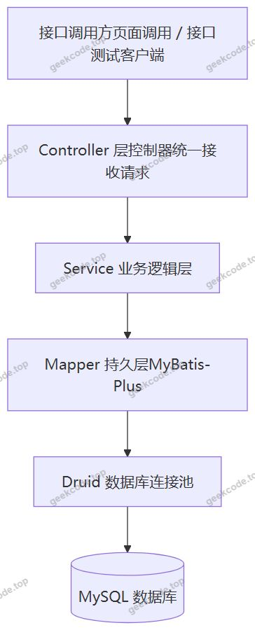
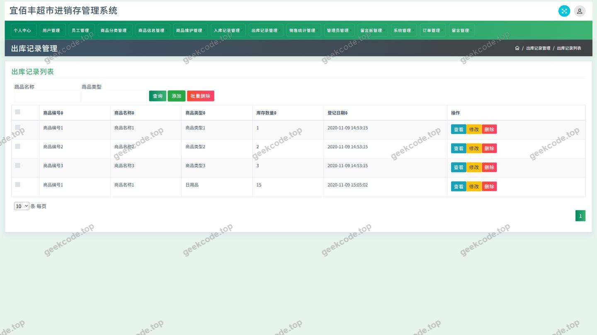
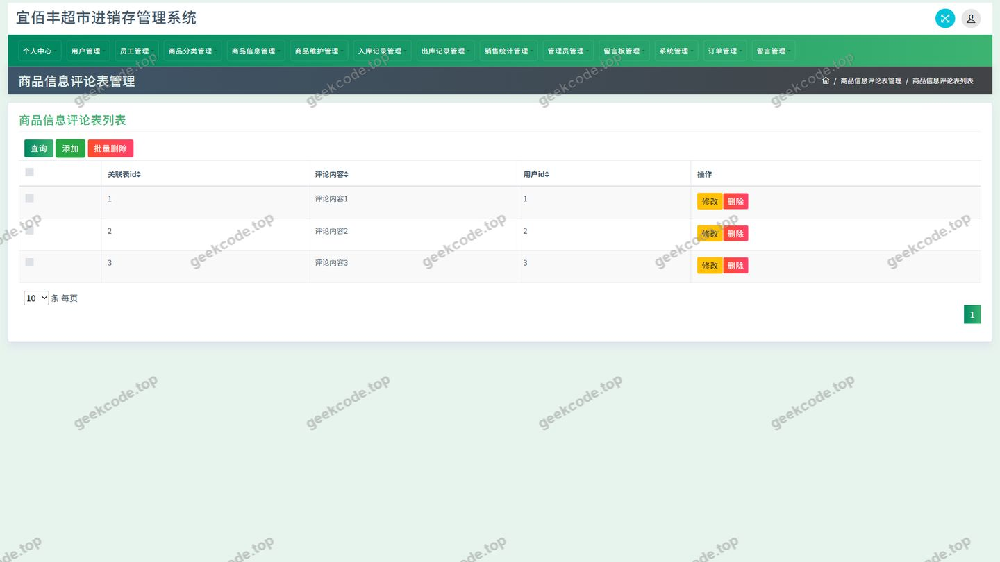
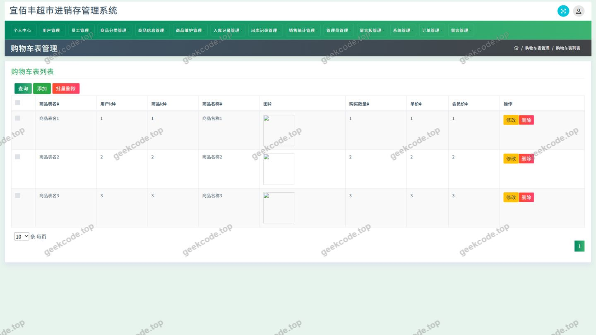
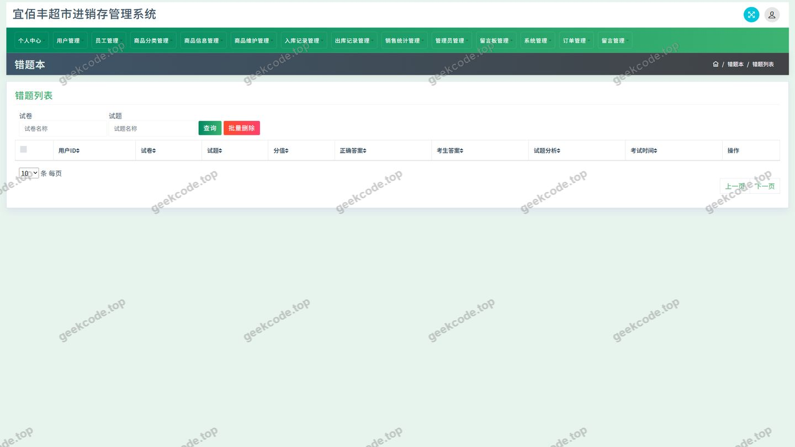
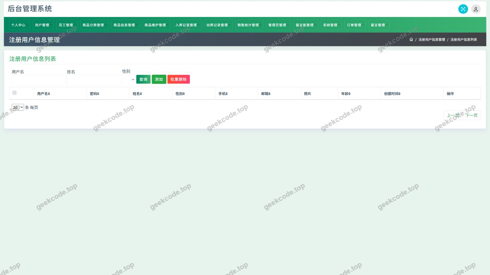
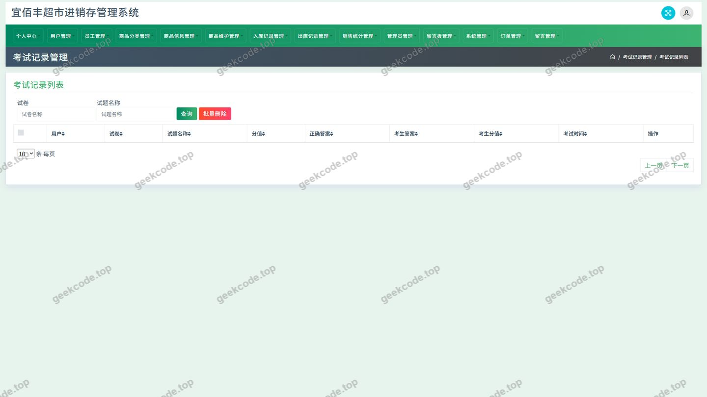
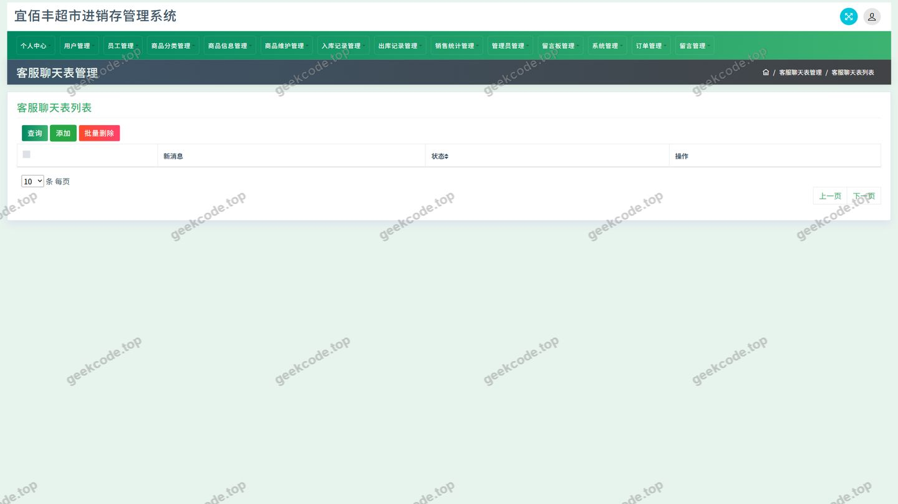
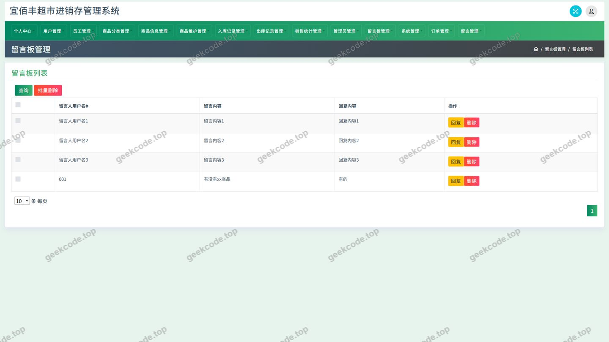

# ssm宜佰丰超市进销存管理系统-java毕业设计-带论文

> 🎓 **计算机毕业设计 · ssm宜佰丰超市进销存管理系统-java毕业设计-带论文**
>
> 本仓库只放**项目介绍 + 运行截图**（截图是站点带水印的原图，存在仓库 `images/` 里）。
>
> 👉 **完整可运行源码 / 数据库脚本 / 部署文档：[点我获取](https://geekcode.top/archives/ssm%E5%AE%9C%E4%BD%B0%E4%B8%B0%E8%B6%85%E5%B8%82%E8%BF%9B%E9%94%80%E5%AD%98%E7%AE%A1%E7%90%86%E7%B3%BB%E7%BB%9F-java%E6%AF%95%E4%B8%9A%E8%AE%BE%E8%AE%A1-%E5%B8%A6%E8%AE%BA%E6%96%87?utm_source=github)**
>
> 💬 咨询微信：**ir9372**　|　🌐 更多项目：[极客代码 geekcode.top](https://geekcode.top/?utm_source=github)
>
> 📌 项目详情页：<https://geekcode.top/archives/ssm%E5%AE%9C%E4%BD%B0%E4%B8%B0%E8%B6%85%E5%B8%82%E8%BF%9B%E9%94%80%E5%AD%98%E7%AE%A1%E7%90%86%E7%B3%BB%E7%BB%9F-java%E6%AF%95%E4%B8%9A%E8%AE%BE%E8%AE%A1-%E5%B8%A6%E8%AE%BA%E6%96%87?utm_source=github>

<table><td width="230" align="center"> <b>扫码加微信 ir9372</b></td><td valign="middle">📦 源码 = 项目介绍 + 全部运行截图 + 数据库 + 部署文档 👉 点上方任意截图，直接跳到 <b>极客代码 geekcode.top</b> 详情页</td></table>

---

<h1>ssm宜佰丰超市进销存管理系统-java毕业设计-带论文</h1>
<h2>项目概述</h2>

宜佰丰超市进销存管理系统是一套面向中小型超市、便利店及零售门店的进销存管理平台，项目代号为 ssm宜佰丰超市进销存管理系统。系统以商品流通为主线，覆盖商品分类、商品信息与评论、商品入库记录、商品出库记录、订单与购物车、收货地址、新闻资讯、留言反馈等核心业务环节，形成&quot;进货—库存—销售&quot;的完整数据链路。

系统采用无前台页面、无后台页面路由的纯接口（pure-api）形态交付，全部业务能力以接口方式对外提供，可由任意前端页面或移动端调用。用户侧提供商品信息浏览、新闻资讯阅读、留言反馈以及个人中心（个人信息、我的订单、我的地址、我的收藏）等能力；管理侧提供用户管理、商品分类与评论管理、入库与出库记录管理、订单管理、新闻资讯管理、留言板管理、客服管理等功能。

项目技术架构为经典 SSM 分层架构，依托 Spring 框架的依赖注入与事务管理、Spring Web MVC 的请求调度、MyBatis-Plus 的持久层简化能力以及 Druid 数据库连接池，适用于高校计算机专业毕业设计、课程设计以及中小型零售企业进销存业务的二次开发场景。

<h2>技术架构</h2>
<h3>整体架构</h3>

项目为纯接口服务，未包含前端工程，也不存在前台路由与后台路由配置，所有能力通过控制器暴露的接口对外提供服务。整体采用 Controller—Service—Mapper 的三层结构，由 Spring 容器统一管理 Bean 生命周期，由 Spring 声明式事务保障入库、出库、下单等写操作的数据一致性。

各层职责如下：

<ul>
<li><strong>Controller 层</strong>：接收并解析请求参数、进行基础参数校验、调用业务层并统一封装返回结果。现有控制器包括 AddressController、CartController、ChukujiluController、CommonController、ConfigController、DiscussshangpinxinxiController、FileController、MessagesController、NewsController、OrdersController、RukujiluController、ShangpinfenleiController。</li>
<li><strong>Service 业务逻辑层</strong>：承载商品出入库、订单生成、评论与留言提交等业务规则，并通过 Spring 事务管理保证多表写操作的原子性。</li>
<li><strong>Mapper 持久层</strong>：基于 MyBatis-Plus 实现，常规单表增删改查由框架内置方法直接完成，复杂查询通过自定义 SQL 或条件构造器实现，显著减少样板代码。</li>
</ul>
<h3>核心技术选型理由</h3>
<table>
<thead>
<tr>
<th>技术组件</th>
<th>作用</th>
<th>选型理由</th>
</tr>
</thead>
<tbody><tr>
<td>Spring Core / Context / Beans</td>
<td>IoC 容器与依赖注入</td>
<td>统一管理对象生命周期，降低层间耦合</td>
</tr>
<tr>
<td>Spring Web MVC</td>
<td>请求映射与参数绑定</td>
<td>提供清晰的控制器编程模型，便于按业务域拆分接口</td>
</tr>
<tr>
<td>Spring TX</td>
<td>声明式事务</td>
<td>保障订单、入库、出库等多表操作的一致性</td>
</tr>
<tr>
<td>Spring AOP</td>
<td>横切逻辑</td>
<td>便于统一处理日志、事务等非业务关注点</td>
</tr>
<tr>
<td>MyBatis-Plus</td>
<td>持久层框架</td>
<td>在 MyBatis 基础上提供通用 CRUD 与条件构造器，提升开发效率</td>
</tr>
<tr>
<td>Druid</td>
<td>数据库连接池</td>
<td>提供连接复用、SQL 监控与连接池运行状态监测能力</td>
</tr>
<tr>
<td>JUnit</td>
<td>单元测试</td>
<td>对业务逻辑与持久层方法进行验证</td>
</tr>
</tbody></table>

依赖清单由 spring-core、spring-context、spring-context-support、spring-beans、spring-aop、spring-tx、spring-jdbc、spring-web、spring-webmvc、MyBatis-Plus、Druid、JUnit 组成，属于典型的 SSM 技术组合。

<h3>数据库设计要点</h3>

系统数据模型围绕&quot;商品—库存—订单&quot;三条主线组织，主要数据表可由控制器与业务菜单归纳如下：

<ul>
<li><strong>用户相关</strong>：用户表、收货地址表（AddressController）。</li>
<li><strong>商品相关</strong>：商品分类表（ShangpinfenleiController）、商品信息表、商品信息评论表（DiscussshangpinxinxiController）。</li>
<li><strong>交易相关</strong>：购物车表、订单表（CartController、OrdersController）。</li>
<li><strong>库存相关</strong>：入库记录表、出库记录表（RukujiluController、ChukujiluController）。</li>
<li><strong>内容相关</strong>：新闻资讯表、留言反馈表（NewsController、MessagesController）。</li>
<li><strong>系统相关</strong>：系统配置表（ConfigController）及文件资源记录（FileController）。</li>
</ul>

表间关系设计遵循以下要点：

<ol>
<li>商品分类与商品信息为一对多关系，分类作为商品检索与归类的基础维度。</li>
<li>商品信息与商品评论为一对多关系，评论数据关联具体商品，支撑商品详情页的互动展示。</li>
<li>用户与收货地址、订单为一对多关系，订单关联下单用户并记录收货地址快照信息。</li>
<li>购物车以用户与商品为联合维度记录选购数据，在下单流程中转换为订单数据。</li>
<li>入库记录与出库记录分别记录商品数量的增加与减少，共同构成库存变动的审计依据。</li>
</ol>
<h2>功能模块</h2>
<h3>前台用户端</h3>
<ol>
<li><strong>商品信息模块</strong>：提供商品分类导航与商品数据查询能力，用户可按分类浏览商品；商品详情支持查看其他用户对该商品的评论内容，并可提交商品评论。</li>
<li><strong>新闻资讯模块</strong>：由 NewsController 提供新闻资讯的列表与详情查询，用于发布超市促销、公告等信息。</li>
<li><strong>留言反馈模块</strong>：由 MessagesController 提供留言提交与查询能力，用户可向超市方反馈意见。</li>
<li><strong>购物车模块</strong>：由 CartController 提供购物车商品的添加、数量修改、删除与列表查询。</li>
<li><strong>订单模块</strong>：由 OrdersController 提供下单、订单列表查询与订单详情查看，对应个人中心菜单中的&quot;我的订单&quot;。</li>
<li><strong>地址模块</strong>：由 AddressController 提供收货地址的新增、修改、删除与列表查询，对应个人中心菜单中的&quot;我的地址&quot;。</li>
<li><strong>个人中心</strong>：对应&quot;个人中心、我的订单、我的地址、我的收藏&quot;菜单，提供用户个人信息查看与维护，以及收藏数据的访问入口；现有控制器清单中未单独列出收藏控制器。</li>
<li><strong>登录入口</strong>：截图清单中包含登录页面，用于用户身份认证后访问个人中心与下单相关能力。</li>
</ol>
<h3>后台管理端</h3>
<ol>
<li><strong>商品分类管理</strong>：由 ShangpinfenleiController 提供分类的新增、修改、删除与查询，是商品组织结构的维护入口。</li>
<li><strong>商品信息评论管理</strong>：由 DiscussshangpinxinxiController 提供商品评论的查询、审核与删除，对应截图中的&quot;商品信息评论&quot;页面。</li>
<li><strong>入库记录管理</strong>：由 RukujiluController 提供商品入库记录的登记与查询，记录商品数量增加的来源与时间。</li>
<li><strong>出库记录管理</strong>：由 ChukujiluController 提供商品出库记录的登记与查询，对应截图中的&quot;出库记录&quot;页面，与入库记录共同构成库存变动台账。</li>
<li><strong>订单管理</strong>：由 OrdersController 提供订单的查询与状态处理，支撑销售环节的数据管理。</li>
<li><strong>用户管理</strong>：对应截图中的&quot;用户&quot;页面，用于查看与管理平台注册用户信息。</li>
<li><strong>新闻资讯管理</strong>：由 NewsController 提供新闻资讯的发布、修改与删除。</li>
<li><strong>留言板管理</strong>：由 MessagesController 提供留言的查看与处理，对应截图中的&quot;留言板管理&quot;页面。</li>
<li><strong>客服管理</strong>：对应截图中的&quot;客服管理&quot;页面，用于客服相关信息的维护。</li>
<li><strong>系统配置与文件管理</strong>：由 ConfigController 提供系统参数配置能力，由 FileController 提供文件上传与下载能力，由 CommonController 提供各模块共用的公共数据查询接口。</li>
</ol>

截图清单中出现的&quot;cuotiben&quot;&quot;kaoshijilu&quot;等页面名称，在现有控制器列表与业务菜单信息中没有对应的业务功能描述，根据现有信息无法确定其用途。

<h2>用户角色与权限</h2>

系统在业务上划分为系统管理员与普通用户两类角色。

<h3>系统管理员</h3>

管理员负责平台数据的维护与业务流转的监控，可访问以下功能模块：

<ul>
<li>用户管理：查看与维护平台注册用户信息。</li>
<li>商品分类管理：新增、修改、删除商品分类。</li>
<li>商品信息评论管理：查看、审核与删除商品评论。</li>
<li>入库记录管理：登记与查询商品入库记录。</li>
<li>出库记录管理：登记与查询商品出库记录。</li>
<li>订单管理：查询订单信息并处理订单状态。</li>
<li>新闻资讯管理：发布、修改与删除新闻资讯。</li>
<li>留言板管理：查看与处理用户留言反馈。</li>
<li>客服管理：维护客服相关信息。</li>
<li>系统配置与文件管理：维护系统参数、上传与下载业务文件。</li>
</ul>
<h3>普通用户</h3>

普通用户为系统的消费端使用者，登录后可访问以下功能模块：

<ul>
<li>商品信息：按分类浏览商品、查看商品详情与商品评论，并提交商品评论。</li>
<li>新闻资讯：浏览超市发布的新闻与公告。</li>
<li>留言反馈：提交留言内容并向管理方反馈意见。</li>
<li>购物车：添加商品、修改数量、删除购物车商品、查看购物车列表。</li>
<li>我的订单：下单、查看订单列表与订单详情。</li>
<li>我的地址：新增、修改、删除与查询收货地址。</li>
<li>我的收藏：访问个人收藏数据入口。</li>
<li>个人中心：查看与维护个人资料。</li>
</ul>

两类角色的权限边界由登录身份决定：管理类接口面向管理员开放，交易类接口面向登录用户开放，商品、新闻、留言等公共接口面向所有访问方开放。

<h2>项目特色与创新点</h2>
<ol>
<li><strong>进销存业务闭环完整</strong>：系统以商品分类为入口，串联入库记录、出库记录、购物车、订单与评论数据，形成从进货入库到销售出库的完整数据链路，而非单一的商品展示系统。</li>
<li><strong>纯接口架构，前后端彻底解耦</strong>：项目为 pure-api 形态，不绑定任何前端实现，接口可同时服务于 PC 页面、移动端或第三方系统，便于后续扩展与替换前端技术栈。</li>
<li><strong>MyBatis-Plus 提升持久层开发效率</strong>：借助通用 CRUD 与条件构造器减少重复的 SQL 编写，将开发重点集中在出入库、订单等核心业务规则上。</li>
<li><strong>Druid 连接池保障运行可观测性</strong>：通过 Druid 的连接池管理能力，可对数据库连接使用情况与 SQL 执行情况进行监控，便于排查进销存高并发写入场景下的性能问题。</li>
<li><strong>库存变动有据可查</strong>：入库记录与出库记录分别独立建档，任何商品数量的变动均可追溯到具体的记录条目，为库存盘点与差异核查提供依据。</li>
<li><strong>互动能力与交易能力并存</strong>：系统在商品与订单等交易功能之外，同时提供商品评论、留言反馈与新闻资讯，兼顾了零售场景中的信息发布与用户沟通需求。</li>
</ol>
<h2>部署环境</h2>
<h3>软件环境要求</h3>
<table>
<thead>
<tr>
<th>类别</th>
<th>组件</th>
<th>说明</th>
</tr>
</thead>
<tbody><tr>
<td>开发语言</td>
<td>JDK</td>
<td>需安装 JDK，具体版本以项目构建配置为准，建议 1.8 及以上</td>
</tr>
<tr>
<td>构建工具</td>
<td>Maven</td>
<td>用于依赖管理与项目打包，依赖列表见项目 pom 配置</td>
</tr>
<tr>
<td>数据库</td>
<td>MySQL</td>
<td>存储用户、商品、库存、订单、内容等全部业务数据</td>
</tr>
<tr>
<td>数据库连接池</td>
<td>Druid</td>
<td>由项目依赖引入，负责数据库连接的创建、复用与监控</td>
</tr>
<tr>
<td>Servlet 容器</td>
<td>Tomcat 等</td>
<td>Spring Web MVC 需部署于 Servlet 容器中运行</td>
</tr>
<tr>
<td>单元测试</td>
<td>JUnit</td>
<td>用于业务逻辑与持久层方法的测试</td>
</tr>
<tr>
<td>缓存/中间件</td>
<td>无</td>
<td>根据现有依赖信息，项目未引入 Redis、消息队列等中间件</td>
</tr>
</tbody></table>
<h3>环境说明</h3>
<ul>
<li>项目为纯接口服务且无前台工程与后台路由，因此不需要 Node.js 运行环境，也不需要微信开发者工具等小程序端工具。</li>
<li>部署时需先创建 MySQL 数据库并导入业务表结构与初始化数据，再在配置中填写数据库连接地址、用户名与密码，最后通过 Maven 打包并部署到 Servlet 容器中启动。</li>
<li>项目依赖由 spring-core、spring-context、spring-context-support、spring-beans、spring-aop、spring-tx、spring-jdbc、spring-web、spring-webmvc、MyBatis-Plus、Druid、JUnit 构成，启动前需确保上述依赖能够从 Maven 仓库正常拉取。</li>
<li>JDK 与 Tomcat 的具体版本号在现有项目配置中未给出，根据现有信息无法确定。</li>
</ul>
<h2>五、技术特性</h2>
<ul>
<li>使用 MyBatis-Plus 简化数据访问层开发</li>
</ul>
<h2>六、功能模块截图</h2>
<h3>后台管理端</h3>
<h4>页面-出库记录</h4>

<h4>页面-登录</h4>

<h4>页面-商品信息评论</h4>

<h4>页面-用户</h4>

<h4>页面-cuotiben</h4>

<h4>页面-defaultuser</h4>

<h4>页面-kaoshijilu</h4>

<h4>页面-kefuguanli</h4>

<h4>页面-liuyanbanguanli</h4>

---

## 获取完整源码

| 项目 | 说明 |
| --- | --- |
| 项目名 | ssm宜佰丰超市进销存管理系统-java毕业设计-带论文 |
| 运行截图 | 本文 10 张（站点带水印原图，仓库 `images/` 目录） |
| 完整源码 | [https://geekcode.top/archives/ssm%E5%AE%9C%E4%BD%B0%E4%B8%B0%E8%B6%85%E5%B8%82%E8%BF%9B%E9%94%80%E5%AD%98%E7%AE%A1%E7%90%86%E7%B3%BB%E7%BB%9F-java%E6%AF%95%E4%B8%9A%E8%AE%BE%E8%AE%A1-%E5%B8%A6%E8%AE%BA%E6%96%87?utm_source=github](https://geekcode.top/archives/ssm%E5%AE%9C%E4%BD%B0%E4%B8%B0%E8%B6%85%E5%B8%82%E8%BF%9B%E9%94%80%E5%AD%98%E7%AE%A1%E7%90%86%E7%B3%BB%E7%BB%9F-java%E6%AF%95%E4%B8%9A%E8%AE%BE%E8%AE%A1-%E5%B8%A6%E8%AE%BA%E6%96%87?utm_source=github) |
| 咨询微信 | **ir9372**（备注：jingpin-yuanma） |
| 更多项目 | [极客代码 geekcode.top](https://geekcode.top/?utm_source=github) |

> 需要源码、部署、改配置、跑不起来等问题，加微信 ir9372 沟通，说明项目名即可。
